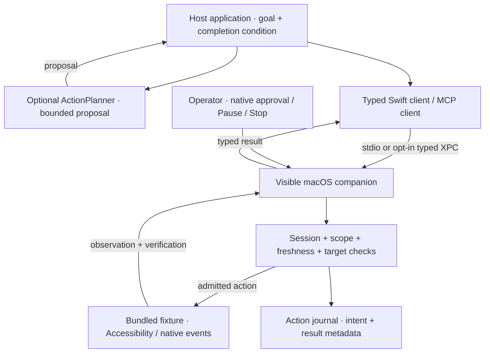

<div align="center">


# Milyonus Computer Use

**Observe with context. Act with permission. Verify the outcome.**

A native Swift foundation for controlled computer use on macOS.<br />
Visible operator controls · Typed contracts · MCP · Bounded agent orchestration

[](Package.swift)
[](#requirements)
[](docs/STATUS.md)
[](#connect-over-mcp)

[Quick start](#quick-start) · [Capabilities](#capabilities-and-evidence) · [Architecture](#how-it-works) · [Documentation](#documentation)

</div>

---

Milyonus Computer Use connects an agent host to a visible macOS companion. The host proposes an operation; the companion checks the approved session, foreground fixture, fresh observation and target before execution. Results carry effect and verification information so the host can decide what actually happened.

> [!IMPORTANT]
> **Fixture-only development preview.** Current desktop operations are restricted to the bundled test app. This is not a general desktop-control product or a signed public release. Implemented features, synthetic checks, native evidence and distribution acceptance are tracked separately in [the status ledger](docs/STATUS.md).

## What makes it useful

| Foundation | What it gives you |
| --- | --- |
| **Visible control** | An AppKit companion with native approval, Pause and Stop. A model cannot approve its own session through MCP. |
| **Explicit execution contracts** | Typed observations, scoped targets, session generations and idempotency keys; uncertain effects are never automatically replayed. |
| **Multiple integration paths** | MCP over stdio, a typed Swift SDK, an opt-in authenticated development XPC path and a default-disabled host coordinator. |
| **Bounded agent runs** | Host-owned goals and completion checks, fresh observations after inference, action/time budgets and no-progress stopping. |
| **Evidence you can inspect** | Standalone regression checks, independent schema validation, native fixture probes and retained acceptance records. |

## Quick start

### Requirements

- **macOS 14+ deployment target** and **Swift 6.2+ toolchain**.
- Recorded development environment: macOS 26.6.2, Apple Silicon, Swift 6.3.3. Minimum-OS runtime and Intel acceptance remain unverified.
- Accessibility permission for native observations and actions. Screen Recording is needed for the capture probe.
- Python 3 for the verification scripts; no provider account is needed for local regression checks.

### 1. Build and package

```sh
git clone https://github.com/ayazelrico/Milyonus-Computer-Use.git
cd Milyonus-Computer-Use

swift build
swift run computer-use-selftest
./scripts/build-apps.sh
```

| Output | Purpose |
| --- | --- |
| `build/MilyonusComputerUse.app` | Native control companion and packaged MCP executable |
| `build/ComputerUseFixture.app` | Isolated application used for desktop acceptance |
| `swift run milyonus-cu` | Diagnostic and explicitly invoked acceptance commands |

The bundles are **ad-hoc signed**. Developer ID signing, notarization and clean-machine distribution acceptance are separate [release gates](docs/release.md).

### 2. Run an approved native fixture check

```sh
open build/ComputerUseFixture.app
python3 -u scripts/live-fixture.py --native-text --native-click
```

When the companion presents a pending session:

1. Use its permission controls to grant any required macOS access.
2. Click **Allow pending fixture session** in the native companion.
3. Bring the fixture to the foreground and leave it there during the run.

The script performs ten Unicode text/save iterations and checks independent fixture state, stale-target rejection, duplicate suppression, secure-field exclusion and pause/cancellation. Physical interaction or switching apps can correctly interrupt the run. The script cannot approve itself.

<details>
<summary><strong>Prefer checks that do not launch windows?</strong></summary>

Initialize the test-only schema validator, then run background verification:

```sh
python3 -m venv .tools/schema-venv
.tools/schema-venv/bin/pip install -r scripts/schema-requirements.lock
./scripts/verify-background.sh
```

This compiles, runs Swift and independent JSON Schema tests, and packages bundles without launching app windows. The standalone self-test executable exits nonzero on failure; it does not require XCTest or Swift Testing in Command Line Tools.

</details>

## Capabilities and evidence

**Evidence snapshot: 1 November 2026.** These are recorded repository results, not a claim that every gate passes or that the checks were rerun for this README. The latest recorded Debug and Release runs each passed **266 cases / 2,761 assertions / zero failures**. See [STATUS](docs/STATUS.md) for run artifacts, failed attempts and remaining work.

| Area | Implemented scope and recorded evidence | Boundary still open |
| --- | --- | --- |
| Observation and semantic actions | Bounded fixture Accessibility observations; `setValue` on input and `press` on Save | Arbitrary applications, OCR and browser DOM adapters |
| Native text and click | Unicode replacement and exact-hit-tested Save clicks; recorded 30-iteration stress slice with 333 checks | Full native interruption and reliability matrix |
| Experimental gestures | Fixture-only vertical scrolling and fixed drag; basic two-action native slice passed on 27 October | Broader interruption matrix; no arbitrary gesture API |
| Agent planners | OpenAI Responses and Anthropic Messages adapters; each has a recorded one-edit native fixture pass | Repeated task/provider acceptance; these are text/AX planners, not vendor built-in computer-use tools |
| Development XPC | Authenticated IPC, connection-owned sessions and a separate control lane; one approved fixture AX edit | Production identity, full native integration and distribution acceptance |
| Read worker isolation | Separate-process, read-only fixture AX slice accepted; later blocked-read Stop attempts passed | Full recovery/performance matrix; the first failed Stop attempt remains recorded |
| Capture | Local fixture capture diagnostics and geometry rejection checks; capture host/controller components implemented | Updated host negative runtime probe not yet run; approved broker dispatch and positive helper capture/Stop/permission acceptance remain open |
| Host integration | Generic, default-disabled coordinator | Application-specific lifecycle and production acceptance |

There is no cross-platform support or accepted multi-display/minimum-OS/Intel matrix. Capability discovery describes available routes; it never grants native authorization. See [capability discovery](docs/capability-discovery.md) and the [next acceptance queue](docs/ACCEPTANCE-NEXT.md).

## How it works



The runner refreshes observations **after planning**, checks target continuity and uses the host's independent completion condition. It stops after three consecutive actions without visible progress. A valid planner `finish` proposal is not sufficient proof of completion.

Sessions expire after five minutes. MCP clients renew the lease every five seconds; 15 seconds without renewal pauses control. The Swift SDK maintains heartbeats independently of inference. A late heartbeat cannot resume a paused session. Focus changes, observed physical input and sleep/session interruption invalidate or interrupt execution. See [session lifecycle](docs/session-lifecycle.md) and [execution admission](docs/execution-admission.md).

## Connect over MCP

Point your MCP client's configuration at the packaged executable, replacing the absolute path:

```json
{
  "mcpServers": {
    "milyonus-computer-use": {
      "command": "/absolute/path/Milyonus-Computer-Use/build/MilyonusComputerUse.app/Contents/MacOS/MilyonusComputerUse",
      "args": ["--mcp"]
    }
  }
}
```

Supported negotiated protocol versions: `2025-11-25` and `2025-03-26`. Unsupported versions fail explicitly. Stdout contains only newline-delimited JSON-RPC. This example does not modify global agent profiles or credentials.

| Tools | Responsibility |
| --- | --- |
| `system_capabilities` | Discover available features and permission state |
| `session_open`, `session_status` | Request a session and inspect its state; opening is not approval |
| `session_heartbeat`, `session_pause`, `session_cancel` | Renew, pause or stop the session |
| `desktop_observe` | Obtain a bounded fixture observation |
| `desktop_action` | Semantic `setValue` for `fixture.input` or `press` for `fixture.save` |
| `desktop_type_text` | Replace fixture input via native keyboard events, then verify the value |
| `desktop_click` | Click the resolved Save center with an exact hit test before each event |

Native text is limited to **1,024 UTF-16 units**; empty text deletes the selected field contents. Other targets and action kinds are rejected. Experimental scroll/drag capabilities are advertised separately; consult the [gesture guide](docs/gesture-execution.md) before using them.

Every action binds a session, generation, observation, target and idempotency key. An identical completed request returns its earlier result; changing content or execution method under the same key fails. Inspect **both effect and verification** in every result. An unresolved persisted intent is an unknown effect, not permission to retry with a new key.

## Integrate with Swift

| Package product | Integration role |
| --- | --- |
| `ComputerUseContracts` | Shared request, observation, capability and result types |
| `ComputerUseClient` | `StdioHarnessClient`, typed `HarnessClient` and optional capabilities |
| `ComputerUseAgent` | `AgentRunner`, `ActionPlanner` and provider adapters |
| `ComputerUseIntegration` | Default-disabled `ComputerUseSessionCoordinator` for host lifecycle management |
| `ComputerUseIPC` | Typed IPC contracts for the development XPC path |

Use `ComputerUseClient.StdioHarnessClient` to own a dedicated companion. Always call `shutdown()` when its owner closes. Cancellation and RPC timeout terminate the child transport rather than replaying uncertain actions. Concurrent opens and late replies are fenced by the [SDK ownership lifecycle](docs/sdk-session-lifecycle.md).

The optional `NativeTextHarnessClient` exposes `typeText(_:)`; `CapabilityHarnessClient.capabilities()` supplies typed feature and permission snapshots. Shared [observation validation](docs/observation-validation.md) and [result validation](docs/action-result-validation.md) reject malformed or contradictory data at integration boundaries.

The host coordinator requires a selection-suspension hook and does not grant native approval. See the [generic integration example](Integrations/ExampleHost/README.md). Host integration requires independent validation.

## Run with a model provider

Provider use is **explicit and opt-in**. Start the fixture, configure the selected provider's variables in the invoking environment, then run one of these commands. Model selection is required; no default model is silently chosen.

| Provider | Required environment variables | Planner API |
| --- | --- | --- |
| OpenAI | `OPENAI_API_KEY`, `MILYONUS_OPENAI_MODEL` | Responses structured planner |
| Anthropic | `ANTHROPIC_API_KEY`, `MILYONUS_ANTHROPIC_MODEL` | Messages tool planner |

```sh
# OpenAI native fixture pilot
swift run milyonus-cu agent-fixture \
  "$PWD/build/MilyonusComputerUse.app/Contents/MacOS/MilyonusComputerUse" \
  --allow-fixture-egress

# Anthropic native fixture pilot
swift run milyonus-cu anthropic-fixture \
  "$PWD/build/MilyonusComputerUse.app/Contents/MacOS/MilyonusComputerUse" \
  --allow-fixture-egress
```

Native approval and foreground fixture focus remain required. These commands make real API requests and may incur charges. Keep keys out of command arguments, repository files and chat messages; credentials stay in the host, not the companion.

The adapters send the host goal/completion condition and minimized `fixture.input`, `fixture.save` and `fixture.status` fields. They do **not** send screenshots, secure-field values or unrelated AX fields. Invalid proposals, refusal, incomplete output and HTTP failures fail explicitly, with no automatic retry or model fallback. See the [provider matrix](docs/provider-matrix.md) for transport details, retained attempts and acceptance boundaries.

## Verification toolbox

| Check | Command | What it exercises |
| --- | --- | --- |
| Core regression | `swift run computer-use-selftest` | Contracts, coordinates, sessions, persistence and lease behavior |
| Background suite | `./scripts/verify-background.sh` | Build, core/schema checks and packaging; no app windows |
| Transport suite | `./scripts/verify.sh` | Real MCP pipes and Swift SDK; launches visible companions, but does not approve or mutate the desktop |
| Native fixture | `python3 -u scripts/live-fixture.py --native-text --native-click` | Approved Unicode text, Save, stale-target, duplicate and interruption checks |
| Permission diagnostics | `swift run milyonus-cu doctor` | Permissions for that invocation |
| Local capture probe | `swift run milyonus-cu capture-fixture` | Fixture-window dimensions, byte count and content hash; no image file or provider transmission |

Close idle companions before transport testing; the verifier does not kill another user's session to acquire its lock. Add `--heartbeat-expiry` to the native fixture script for silent-client expiry, or `--iterations 30` for repeated pointer stress. The expiry check requires the `heartbeatLost` reason so physical interruption cannot masquerade as success.

<details>
<summary><strong>Exercise slow planning without a provider key</strong></summary>

```sh
swift run milyonus-cu agent-fixture-selftest \
  "$PWD/build/MilyonusComputerUse.app/Contents/MacOS/MilyonusComputerUse"
```

This deterministic planner waits 18 seconds before proposing an edit. The SDK must maintain the lease while inference is simulated, and the runner must refresh its target before execution. Native approval is still required. This is not model inference evidence.

</details>

## Permissions, data and recovery

- **OS permissions stay with macOS.** The harness never edits TCC or self-grants access. Direct-child launches can have different attribution from Launch Services; a companion toggle alone is not a verified SDK revocation mechanism. See [permission attribution](docs/permission-attribution.md).
- **Approval is a separate native action.** No MCP tool grants approval. This is not a claim that arbitrary same-user software cannot synthesize a native button click.
- **The journal records intent and outcomes.** `~/Library/Application Support/MilyonusComputerUse/actions-v1.json` stores hashes and result metadata, not raw input text. The 2,000-entry cap has no automatic retention/export. Do not delete unresolved intents to force a retry.
- **Locks are not authentication.** The adjacent advisory lock coordinates cooperating processes. Development XPC authentication has its own [identity and transport boundary](docs/authenticated-ipc.md).
- **Uncertain effects require reconciliation.** Inspect actual fixture state before deciding what comes next. Restarting or inventing a new idempotency key does not make replay safe.

For the detailed security boundary, read the [threat model](docs/security/threat-model.md), [security review](docs/security/review.md) and [release/recovery runbook](docs/release.md).

## What comes next

The [remaining-work plan](docs/HARNESS-REMAINING-PLAN.md) and [acceptance queue](docs/ACCEPTANCE-NEXT.md) track the gates beyond individual passing slices:

- Capture worker runtime integration, approved broker dispatch and native interruption acceptance.
- Broader provider task repetitions, native interruption/recovery and performance coverage.
- Normal host integration and independent client acceptance.
- Minimum-OS, Intel and multi-display runtime validation.
- Developer ID signing, notarization, clean-machine permissions, updates, rollback and uninstall.

Intermittent stdio timeout investigations also remain open; see [the retained investigation](docs/stdio-timeout-investigation.md). Passing synthetic tests does not close these gates or justify broadening the fixture allowlist.

## Documentation

| If you want to… | Start here |
| --- | --- |
| Understand current evidence and unresolved work | [Status ledger](docs/STATUS.md) · [Acceptance queue](docs/ACCEPTANCE-NEXT.md) |
| Understand components and trust boundaries | [Architecture](docs/architecture.md) · [Development boundary ADR](docs/adr/001-development-boundary.md) |
| Integrate a client or agent host | [SDK lifecycle](docs/sdk-session-lifecycle.md) · [Agent adapter boundary](docs/agent-adapter-boundary.md) · [external host integration](Integrations/ExampleHost/README.md) |
| Inspect schemas and feature negotiation | [Schemas](Schemas/README.md) · [Capability discovery](docs/capability-discovery.md) |
| Explore worker and IPC isolation | [Read-worker lifecycle](docs/read-worker-lifecycle.md) · [Authenticated IPC](docs/authenticated-ipc.md) · [Control lane](docs/xpc-control-lane.md) |
| Evaluate capture or pointer gestures | [Capture plan](docs/capture-acceptance-plan.md) · [Capture geometry](docs/capture-geometry.md) · [Gesture execution](docs/gesture-execution.md) |
| Package, diagnose or recover | [Development packaging](docs/development-packaging.md) · [Permission attribution](docs/permission-attribution.md) · [Release runbook](docs/release.md) |

### Contributing

Read [AGENTS.md](AGENTS.md) and the current status before changing scope. Keep implementation code, UI, tests and new implementation documentation in English. Preserve the fixture boundary and distinguish synthetic, native, provider and distribution evidence in changes. Run the checks appropriate to your change and include the evidence with your pull request.

The original Turkish planning inputs remain available in [plan.md](plan.md) and [Plan Actions.md](<Plan Actions.md>). They provide historical context; current acceptance is recorded in the status ledger.

No license file is currently included in this repository; do not infer a reuse license from its public visibility.

---

<div align="center">

**Milyonus · Computer Use**<br />
<sub>Native controls. Explicit boundaries. Verifiable outcomes.</sub>

</div>
