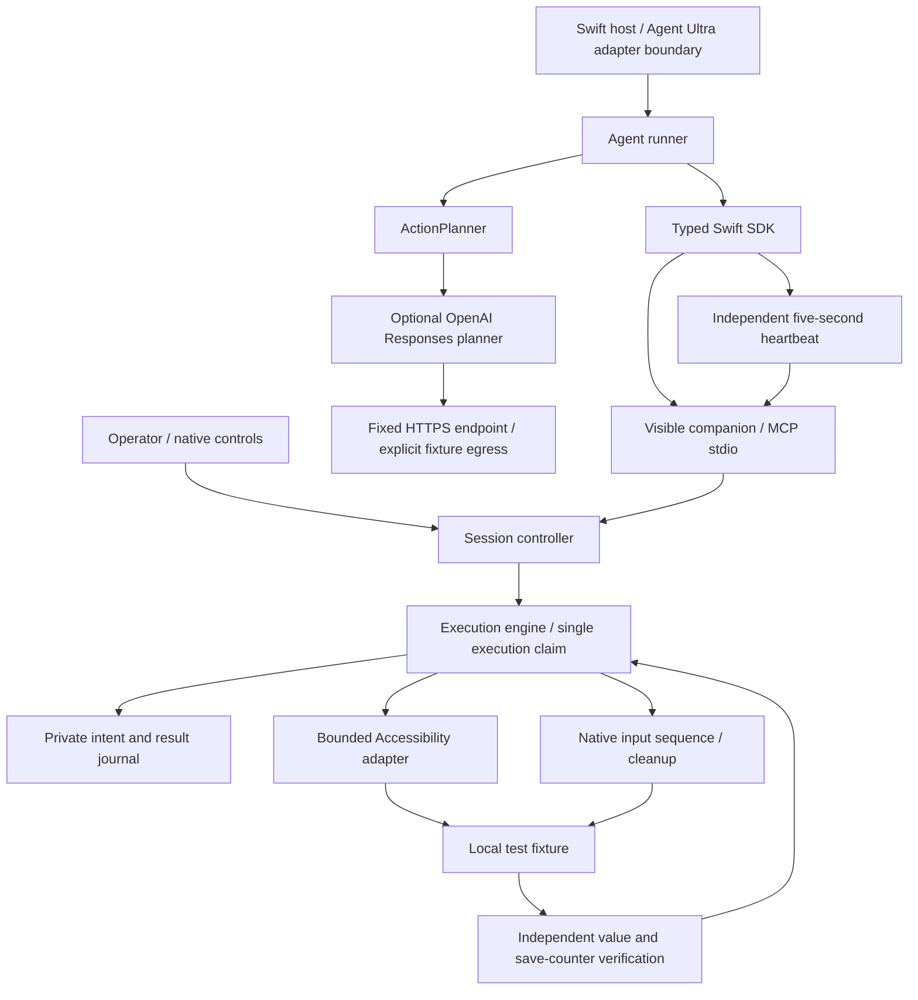

# Current architecture

This describes the implemented development preview. Production IPC identity, broader application policy and release signing remain separate gates.

## Authority

Only native controls approve or resume a session. The planner proposes a semantic action; it cannot choose session grants, expiry, generation or idempotency keys. The runner obtains a fresh observation after inference and constructs the request. The companion validates scope, readiness, generation, freshness, exact target and focus before journaling intent. Native input revalidates before every event. Unknown effects are not retried.

The independent heartbeat task keeps a healthy client alive while inference is pending. If heartbeats stop, the companion pauses at the monotonic deadline and invalidates generation. A late heartbeat cannot restore native authority. Session status includes why a pause happened.

## Transport and process boundaries

The Swift SDK launches a dedicated visible companion with sanitized environment and inherited stdio pipes. This prevents accidental provider-token inheritance; it is not production peer attestation. The process lease is advisory coordination among companion instances, not authentication of arbitrary local software. The companion still executes bounded AX calls on MainActor, so hostile-AX isolation remains open.

Provider HTTP runs in the host client, not in the companion. The host explicitly selects the model, supplies the key closure and opts into fixture observation egress. The planner sends only selected fixture fields. The MCP companion has no provider-key tool, image-egress tool or network control endpoint.

## Verification layers

1. Standalone Swift tests exercise contracts, session/lease transitions, persistence, input cleanup, execution serialization, runner checks and synthetic provider responses.
2. Real MCP subprocess tests exercise framing, handshake, tool boundaries and malformed requests. SDK smoke tests exercise the typed client over actual pipes without approving native actions.
3. Native fixture scripts verify observed effects, duplicate suppression, focus/target checks and heartbeat expiry. Individual modes have separate evidence artifacts.
4. The deterministic SDK pilot adds an 18-second planning delay to test real client liveness and refresh of observation handles. It is not provider inference.
5. Real provider and Agent Ultra pilots, production identity, physical interruption/hardware matrices and distribution acceptance remain pending until their own evidence exists.
