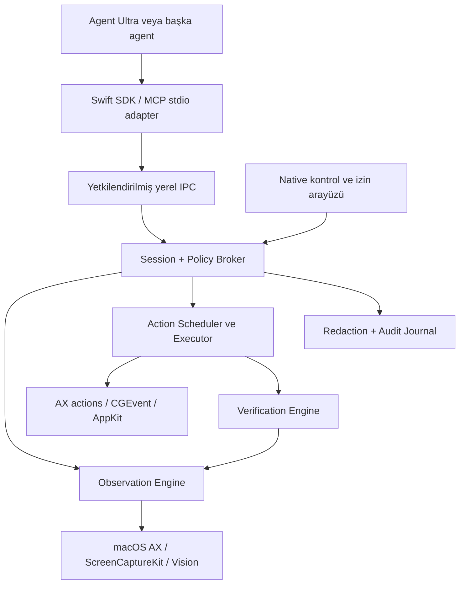

# Millionus Computer Use Harness — Ana Plan

> Implementation has started. Current English implementation status, evidence, and unmet gates are maintained in [docs/STATUS.md](docs/STATUS.md). The original planning checklist below is not a claim of completed implementation.

## Current ownership and remaining delivery (2026-10-28)

Milyonus Agent Ultra is owned by another agent at the user's explicit request. This workstream must not read, edit, build, test or launch that checkout. Continue only the harness work defined in [remaining delivery plan](docs/HARNESS-REMAINING-PLAN.md). Historical integration requirements below remain context, not authorization to work in the other checkout.

Tarih: 24 Ekim 2026 · Sürüm: 0.1 · Durum: uygulama öncesi mimari ve teslimat planı

Bu belge macOS üzerinde çalışan, farklı LLM/agent sistemlerinin bilgisayarı gözlemlemesini ve kontrollü biçimde kullanmasını sağlayacak harness'ı tanımlar. Bu teslimat planlama aşamasıdır; çalışan harness, test edilmiş entegrasyon veya dağıtıma hazır ürün iddiası değildir. Uygulama iş listesi: [Plan Actions.md](<Plan Actions.md>).

Kullanıcının ürün adı “Millionus”; mevcut dizin ve Swift adlandırması “Milyonus” biçimindedir. Mevcut klasörler yeniden adlandırılmayacak. Kod için `MilyonusComputerUse`, komut için `milyonus-cu` önerilir; yayın öncesi marka adı kesinleştirilir.

## 1. Hedef ve kapsam

Hedef: agent'ın kullanıcı tarafından verilen bir işi `gözlemle → hedef belirle → politika kontrolü → uygula → sonucu doğrula` döngüsüyle gerçekleştirebilmesi. Sadece ekran görüntüsü alan veya fare tıklayan bir araç yeterli değildir. Oturum, hedef kimliği, izin, iptal, hata toparlama, model adaptasyonu ve kanıt kaydı aynı sistemin parçalarıdır.

Başlangıç platformu Apple Silicon Mac, macOS 14 ve üzeri olarak önerilir; minimum sürüm P0 teknik denemesinde kesinleştirilir. Intel ayrı uyumluluk kapısıdır; test edilmeden destekleniyor denmez. macOS 14 tabanı mevcut Agent Ultra paket hedefiyle uyumludur. Windows/Linux ilk sürüm kapsamına girmez; platform arayüzleri gelecekte port etmeyi mümkün kılar.

İlk çalışan sürümün kapsamı:

- Uygulama/pencere keşfi, izin durumu, sınırlandırılmış AX ağacı ve ekran görüntüsü.
- Semantik öğe seçimi; gerektiğinde görüntü koordinatıyla tıklama, kaydırma, klavye ve metin girişi.
- Tek masaüstünde tek etkin yazıcı, görünür oturum, duraklatma, acil durdurma.
- Tipli komutlar, sınırlı yerel IPC, Swift istemci ve CLI; ardından MCP stdio adaptörü.
- Bağımsız fixture uygulamasında kanıtlanmış görevler; sonra seçili gerçek uygulamalar.
- Agent Ultra'ya ayrı bir computer-use akışı üzerinden entegrasyon.

İlk sürüm dışında: root yetkisi, giriş ekranını yönetme, FileVault kilidini açma, TCC izinlerini otomatik verme, gizli arka plan kontrolü, keyfi shell/AppleScript yürütme, uzaktan internet erişimli kontrol sunucusu, tüm uygulamalarda kusursuz otomasyon, tüm işlemlerde geri alma garantisi. Parola/2FA/CAPTCHA gerektiğinde kullanıcıya devir yapılır. Clipboard, OCR, tarayıcı DOM köprüsü ve gelişmiş sürükleme aşamalı eklenir.

## 2. İnceleme bulguları ve kanıt sınırı

İncelenen proje: `/Users/ayazelrico/Desktop/Milyonus-Agent-Ultra`.
Yeni çalışma alanı: `/Users/ayazelrico/Desktop/Milyonus-Computer-Use`; inceleme başlangıcında boştu.
İnceleme anında Ultra HEAD: `4ac7abd`; çalışma ağacı temiz değildi. Dolayısıyla bulgular yalnızca bu commit'e değil, yerel dosyaların 24 Ekim anlık durumuna aittir. Mevcut değişikliklere dokunulmadı.
Yerel ortam: macOS 26.6.2, arm64, Swift 6.3.3. Bu bilgi macOS 14 veya Intel uyumluluğu kanıtlamaz.

| İncelenen kaynak | Gözlem | Mimariye etkisi |
|---|---|---|
| `Package.swift` | Swift tools 5.10, macOS 14, tek executable target | Harness ayrı Swift package ve modüller olarak kurulmalı |
| `README.md` | Native masaüstü, VS Code arayüzü, CLI hesapları, shadow/review akışı | Yeni computer-use modu mevcut dosya önerisi akışından ayrılmalı |
| `Services/Bridge/ChatEngine.swift` | Request/chat kimlikleri, istemci türleri, iptal ve yerel giriş noktası | Typed adapter ve ayrı run kimliği kullanılmalı; mode string eklemek tek başına yeterli değil |
| `Services/Bridge/ChatSink.swift` | Ortak olay gönderme/bitirme arayüzü | Computer-use olayları uyarlayıcı üzerinden UI'ya aktarılabilir |
| `Services/Bridge/BridgeService.swift` | Loopback bridge, launch başına token, owner-only keşif dosyası | Mevcut bridge token'ı masaüstü yetkisi olarak yeniden kullanılmamalı |
| `Services/Bridge/AgentSandbox.swift` | Shadow/scratch yazma sınırı; AppleEvent ve çeşitli süreç devretmeleri engelli | Harness broker'ı kontrollü yeni yetki sınırıdır; sandbox genel olarak gevşetilmemeli |
| Aynı sandbox dosyası | Okuma ve ağ kısıtlamaları tam değil; bazı IPC yolları açık risk olarak belirtilmiş | Mevcut sistemi tam veri sızıntısı izolasyonu diye sunmamalı |
| `Services/SelectionMonitor.swift` | AX, event tap, zaman aşımı ve clipboard fallback tecrübesi | Davranış ve testler referans alınmalı; singleton doğrudan harness'a taşınmamalı |
| `Desktop/WebMessage.swift` | Web mesajları tip/sınırlı boyut doğrulamasından geçiyor | UI mesajı yetki kaynağı olamaz; derin doğrulama ve native onay gerekir |
| `Services/AgentHub/HubModels.swift` | Approval ve faaliyet modelleri | Yeni kapsamlı yetki kaydı eski allow/deny enum'una indirgenmemeli |
| `Services/Ultra/UltraCoordinator.swift` | Ayrı round kimlikleri, stop/retry yaşam döngüsü | Geç gelen sonuçların çalışmayı diriltmemesi örnek alınmalı |
| `docs/ultra/Ultra-Handover.md` | Ultra beta gizli; model aşamaları araçsız/sınırlı; canlı kabul açık işleri var | Ultra otomatik olarak computer-use çalıştırabilir varsayımı yapılmamalı |

Bu inceleme kaynak kod odaklıdır; mevcut uygulamanın tüm dosyaları veya bütün güvenlik sınırları denetlenmedi. Handover'daki test sayıları tarihsel beyanlardır; bu görevde yeniden çalıştırılmadı. Hesap token'ları, Keychain ve kullanıcı sohbet verileri okunmadı.

## 3. Başarı tanımı

Üç ayrı başarı düzeyi vardır:

1. **Motor doğruluğu:** Bilinen komut doğru fixture öğesini değiştirir; güvenli retler doğru çalışır.
2. **Agent başarısı:** Model doğru komut dizisini seçer ve görev sonucunu bağımsız kanıtla doğrular.
3. **Ürün güvenilirliği:** İzin, dağıtım, iptal, güncelleme ve mevcut Ultra davranışları gerçek kullanıcı oturumunda çalışır.

Bir tıklama olayının işletim sistemine gönderilmiş olması görevin tamamlandığı anlamına gelmez. Sonuçlar `verified`, `failed`, `unknown`, `cancelled` olarak ayrılır. Belirsiz sonuç “başarılı” yazılmaz. Modelin kendi başarı cümlesi tek başına doğrulama değildir.

## 4. Temel mimari kararları

| Karar | Seçim | Gerekçe ve bedel |
|---|---|---|
| Native çekirdek | Swift; AppKit/ApplicationServices/CoreGraphics/ScreenCaptureKit | macOS API'lerine doğrudan erişim; platform bağımlılığı adapter sınırında kalır |
| Model bağımsızlığı | Harness inference sahibi değil; optional agent-loop katmanı ayrı | CLI/API sağlayıcılarına bağlanmadan motor test edilebilir |
| Yetkili yürütücü | Kullanıcı oturumunda görünür companion app + broker | TCC kimliği ve kontrol UI'sı sabitlenir; root daemon gerekmez |
| Native IPC | XPC tercih; imzalı istemci doğrulaması P0 denemesi | Dağıtım ve sandbox uygunluğu kanıtlanmadan mimari kesinleşmez |
| Harici araç yüzeyi | İnce MCP stdio adapter | Protokol ile macOS yetkileri ayrılır; HTTP ilk sürümde yok |
| Hedefleme | Önce uygun AX eylemi; ardından görünürlük doğrulanmış görüntü fallback'i | Semantik doğruluk + AX sunmayan uygulamalara kapsama |
| Eşzamanlılık | Kullanıcı oturumu başına tek mutasyon lease'i | Birden çok ajan aynı fare/klavyeyi eşzamanlı yönetemez |
| Kalıcılık | Sürümlemeli metadata/journal; görüntüler varsayılan geçici | Debug ihtiyacı ile mahremiyet dengesi |
| Yetki yönetimi | Oturum kapsamı + native doğrulanan grant | Her tıklamada soru sormadan kapsamı uygular |
| Dağıtım | İlk hedef Developer ID ile dağıtılan uygulama | App Store uygunluğu ayrı değerlendirme; garanti edilmez |

XPC uygun olmazsa fallback, owner-only Unix socket + oturum yetkisi + eş kullanıcı/istemci doğrulamasıdır. Sadece `0600` veya aynı UID kontrolü, aynı kullanıcı adına çalışan kötü amaçlı süreçlere karşı güçlü kimlik kanıtı sayılmaz. Bu risk ayrı tehdit modeliyle belgelenmeden fallback üretime geçmez. Harness yetkisi genel bir “komutu benim adıma çalıştır” servisine dönüşmemeli.

## 5. Bileşenler ve bağımlılık yönü



Önerilen depo:

```text
Package.swift
Sources/
  ComputerUseContracts/       # Codable modeller; macOS UI bağımlılığı yok
  ComputerUseCore/            # policy, session, scheduler, state machine
  ComputerUseMacOS/           # AX/capture/input/display adapters
  ComputerUseIPC/             # yetkili istemci ve broker sınırı
  ComputerUseClient/          # Swift SDK
  ComputerUseMCP/             # protokol çevirisi
  ComputerUseCLI/             # doctor, observe, kontrollü action
  ComputerUseApp/             # görünür companion ve native kontroller
Tests/
  ContractsTests/
  CoreTests/
  MacOSAdapterTests/
  IntegrationTests/
Fixtures/ComputerUseTestApp/
Schemas/v1/
Integrations/AgentUltra/
Benchmarks/scenarios/
scripts/
docs/adr/
docs/security/
docs/evidence/
```

Bu ağaç hedeftir; bu plan teslimatında bu modüller oluşturulmadı. Core işletim sistemi etkilerini protocol üzerinden çağırır. Fake clock, fake capture, fake AX ve fake input ile deterministik testler mümkündür. Platform API'lerinin bloklanması ana UI thread'ini durdurmamalı; AX işlerindeki süre sınırları ve gerekirse worker process P0'da ölçülür. UI MainActor'da, session/scheduler actor izolasyonunda tutulur.

## 6. Gözlem sistemi

Her observation aşağıdakileri içerir:

- `sessionId`, `observationId`, artan `sequence`, monotonic zaman ve tanı amaçlı duvar saati.
- Aktif app bundle ID, PID ve süreç başlangıç kimliği; pencere kimliği ve başlık için gizlilik politikası.
- Display kimliği, bounds, ölçek, orientation, crop ve açık koordinat dönüşümü.
- Sınırlı AX öğeleri: rol, izinli label/value, bounds, desteklenen eylemler, enabled/focused bilgisi.
- Capture/AX ayrı zaman damgaları; atomik snapshot olmadıkları için tutarlılık/skew bilgisi.
- Görüntü artifact referansı, redaction durumu, eksik/kırpılmış veri ve hata nedeni.

AX traversal döngü korumalı ve bounded olur: başlangıç hedefi en fazla 2.000 node, derinlik 30, süre 500 ms; ölçümle güncellenir. Büyük ağaç sessiz kesilmez; `truncated` ve neden döner. Değişmeyen observation'lar hash/diff ile küçültülebilir fakat eski frame yeniymiş gibi etiketlenmez.

Ekran yakalama yalnızca izinli pencere veya ekran kapsamındadır. Mümkün olduğunda hedef pencereyle sınırlanır. Capture yoksa AX-only gözlem açıkça belirtilir; screenshot gerektiren eylem çalıştırılmaz. Boş/siyah görüntü otomatik olarak geçerli ekran kabul edilmez. Ses/mikrofon kaydı kapsam dışıdır.

OCR yerel Vision adapter olarak ikinci aşamadadır; OCR metni gerçek AX öğesi sayılmaz. OCR kutusundan yapılan tıklama görsel hedefleme politikasına tabidir. Görüntü ve ekran metni güvenilmeyen dış içerik olarak etiketlenir.

## 7. Koordinat ve hedef kimliği sözleşmesi

Tek kanonik alan: üst-sol başlangıçlı global masaüstü **point** koordinatları. Capture **pixel** koordinatları yalnızca frame'in dönüşüm matrisiyle bu alana çevrilir. AppKit alt-sol koordinatları adapter içinde dönüştürülür. Negatif origin'li harici ekranlar, Retina, farklı ölçekli ekranlar ve crop offset'i test edilir.

Her coordinate action `observationId`, `displayId`, `displayLayoutVersion`, frame/crop referansı ve hedef pencere kimliği ister. Monitör çıkarıldığında veya ekran düzeni değiştiğinde eski hedef geçersizdir. Normalize 0–1 koordinatı tek başına kabul edilmez; kaynak frame zorunludur.

AX `elementId` kalıcı global ID değildir. Session/observation sınırında üretilen handle'dır. Rol, app/process kimliği, pencere, ancestor bilgisi ve bounds ile yeniden çözülür. Birden fazla eşleşme varsa otomatik ilk öğe seçilmez. `TARGET_AMBIGUOUS` döner.

Her mutasyondan hemen önce odak, görünürlük, izin, hedef kimliği ve ekran düzeni yeniden kontrol edilir. Eski hedef reddedilip yeniden gözlem istenir. Ön kontrol ile gerçek olay arasındaki yarış bütünüyle yok edilemez; kısa olay dizileri, kullanıcı müdahalesi takibi ve son kontrol riski azaltır. “Yanlış pencereye hiçbir koşulda yazamaz” şeklinde mutlak garanti verilmez.

## 8. Araç yüzeyi

| Araç | İşlev | Temel sınır |
|---|---|---|
| `system.capabilities` | Sürüm, desteklenen özellik, izin durumları | İzin istemez, yan etki oluşturmaz |
| `session.open/status/close` | Oturum ve kapsam yaşam döngüsü | Native grant olmadan mutasyon yetkisi üretmez |
| `desktop.observe` | Birleşik AX/capture snapshot | Yetkili kaynak + veri bütçesi |
| `desktop.apps/windows` | Uygulama/pencere keşfi | Yetkisiz içerik ayrıntısı yok |
| `desktop.activate` | Hedef uygulamayı/pencereyi etkinleştirme | Aktivasyon da mutasyondur |
| `desktop.action` | Tipli click/press/type/scroll/drag | Tek action union; keyfi script yok |
| `desktop.wait` | Koşul veya sınırlı bekleme | Süresiz polling yok |
| `desktop.verify` | Beklenen son durum kontrolü | Model cümlesinden bağımsız kanıt |
| `session.pause/resume/cancel` | Kontrol ve iptal | İptal yüksek öncelikli ve idempotent |
| `artifact.read` | Session'a bağlı görüntü/kanıt | Keyfi dosya yolu okunamaz |

Model aracı `approval.allow` gibi bir komutla kendine yetki veremez. Native kullanıcı olayı grant üretir; agent sadece mevcut grant'e referans verir. Clipboard ve URL açma gibi ek araçlar ayrı capability olarak sürümlenir.

Örnek iç protokol komutu; MCP zarfı değildir:

```json
{
  "schemaVersion": "1.0",
  "requestId": "req-0001",
  "sessionId": "session-0001",
  "idempotencyKey": "action-0001",
  "observationId": "obs-0012",
  "leaseGeneration": 3,
  "deadlineMs": 5000,
  "action": {
    "kind": "press",
    "target": {"elementId": "element-0042"}
  },
  "expected": {"kind": "elementExists", "role": "AXStaticText", "label": "Saved"}
}
```

Yanıt: `requestId`, `actionId`, `status`, `effectState`, `verification`, `beforeObservationId`, `afterObservationId`, `timings`, `error`, `retryAdvice`. `effectState`: `notApplied | applied | unknown`; `verification`: `passed | failed | unavailable`.

Bilinmeyen action türleri reddedilir. Sayısal taşma, NaN, negatif deadline, aşırı metin, derin JSON ve bilinmeyen zorunlu alanlar doğrulanır. Başlangıç sınırları: JSON kontrol mesajı 256 KiB, text action 16 KiB, action deadline en çok 30 saniye. Büyük görüntü kontrol JSON'unda taşınmaz; session-bound artifact olur. MCP görüntü teslimi için adapter kendi negotiated sınırlarına göre encode eder.

## 9. Eylem yürütme ve toparlama

Eylem hattı: şema → session/auth → scope/policy → lease → tazelik/odak → journal intent → execution → observation → verification → journal result.

- Semantik `AXPress` veya desteklenen value setter tercih edilir; setter uygulanmış olsa da UI sonucu doğrulanır.
- Görsel click için visible bounds ve occlusion kontrolü; hedef önündeki modal/popup ayrıca değerlendirilir.
- Klavye fiziksel keycode ile Unicode metin girişini ayırır. Türkçe Q/F, İngilizce layout, emoji, combining karakter, IME ve dead key fixture'ları gerekir.
- Clipboard varsayılan metin yolu değildir. Opt-in fallback'te mümkün olan pasteboard tipleri korunur; changeCount değişmişse kullanıcının yeni clipboard'u eski veriyle ezilmez. Eksiksiz geri yüklenemeyen türler önceden belirtilir.
- Key-down/mouse-down durumu izlenir; cancel/timeout cleanup modifier ve button release dener. Sert process kill sonrası garanti verilemez; broker/helper watchdog ve kullanıcı kurtarma yolu test edilir.
- Drag küçük iptal edilebilir parçalara ayrılır; koordinat ve odak doğrulaması yapılır. İlk MVP'de fixture dışı drag desteklenmeyebilir.
- Bekleme fixed sleep yerine mümkünse AX/window olayı + bounded polling ile yapılır. Maksimum retry, süre ve eylem sayısı bütçesi vardır.

Idempotency: aynı key ve aynı payload önceki durumu döndürür; aynı key farklı payload `IDEMPOTENCY_CONFLICT` olur. Intent kaydından sonra crash olursa yan etki bilinmiyor olabilir. UI üzerinde tam “exactly once” garanti edilmez. Belirsiz submit/send/delete tekrar çalıştırılmaz; önce durum uzlaştırılır veya kullanıcıya devir edilir. Yeni key oluşturmak bu kuralı aşamaz; görev bağlamındaki duplicate effect de kontrol edilir.

Hata sınıfları: `PERMISSION_REQUIRED`, `PERMISSION_REVOKED`, `UNAUTHORIZED`, `POLICY_DENIED`, `LEASE_BUSY`, `STALE_OBSERVATION`, `TARGET_NOT_FOUND`, `TARGET_AMBIGUOUS`, `FOCUS_CHANGED`, `USER_INTERRUPTED`, `TIMEOUT`, `VERIFICATION_FAILED`, `EFFECT_UNKNOWN`, `UNSUPPORTED_CAPABILITY`, `PROTOCOL_MISMATCH`, `RESOURCE_LIMIT`.

Sadece `notApplied` ve güvenle tekrar edilebilir hata otomatik tekrar edilir. Retry en fazla iki yeniden deneme; her seferinde yeni gözlem ve politika kontrolü. Eylem uygulanıp doğrulama başarısızsa körlemesine tekrar yapılmaz.

## 10. Oturum, insan müdahalesi ve concurrency

Durum makinesi:

```text
created → awaiting_permission → ready → running → verifying → ready
running/ready/verifying → paused_user | awaiting_approval | failed | cancelled
ready → completed
process restart → interrupted
```

Terminal durumdaki run geç gelen model veya capture sonucu ile yeniden açılmaz. Resume yeni generation alır; eski action, target ve grant uygun şekilde geçersizleşir. Uzun model isteği sırasında lease sonsuza kadar tutulmaz; lease TTL/heartbeat ve oturum bütçesi vardır. Başlangıç önerisi: 30 saniye lease, 5 saniye heartbeat; gerçek model gecikmesiyle ayarlanır. Aktif yazıcı değişimi eski pending action'ları iptal eder.

Fiziksel kullanıcı klavye/fare etkileşimi tespit edildiğinde yeni mutasyon durur; agent kaynaklı event'leri ayrıştırmak için etiketleme ve gerçek donanım deneyi gerekir. Bu ayrım güvenlik kimliği sayılmaz. Capture/read işlemleri de kapsam kontrolünden geçer. Çoklu agent planlama yapabilir; yalnızca lease sahibi execute eder.

Native Stop her zaman görünür olmalıdır. Global kısayol ikincil yoldur; permission veya event tap çalışmıyorsa menü/companion Stop kalır. Kilit, uyku, ekran oturumu değişimi ve disconnect duraklatır. Uyanınca otomatik tuş basılmaz; yeniden gözlem ve kullanıcı resume gerekir.

## 11. Yetki ve tehdit modeli

Korunan varlıklar: kullanıcının masaüstü kontrolü, özel ekran içeriği, kimlik bilgileri, dosyalar ve dış dünyada oluşan etkiler. Güvenilmeyen kaynaklar: web sayfası metni, OCR, belge, e-posta, model çıktısı, MCP istemci payload'u ve üçüncü taraf uygulama.

Yetki katmanları birbirinin yerine geçmez:

1. macOS TCC izni: ilgili executable/app kimliğinin teknik erişimi.
2. Harness session scope: hangi app/pencere, hangi işlem, ne kadar süre.
3. Görev yetkisi: kullanıcının amaç ve kapsamı.
4. Gerekirse somut sonuç için native onay: alıcı, içerik, tutar veya silinecek hedefe bağlı.

Normal gezinme ve geri alınabilir yazma, verilen kapsamda tekrar tekrar onay istemez. Gönderme, satın alma, kalıcı silme gibi dış etkilerde mevcut kullanıcı talimatının yeterliliği değerlendirilir; yeni/eksik yetki gerekiyorsa tam somut işlem gösterilir. Grant payload hash, session, scope, süre ve generation'a bağlıdır. İçerik/hedef değişirse tekrar değerlendirilir.

Generic GUI üzerindeki bir “click”in ekonomik veya dış etkisini kusursuz sınıflandırmak mümkün değildir. Bu nedenle güvenlik yalnızca buton etiketi veya LLM risk puanına dayanmaz. V1 kontrollü uygulama/akış allowlist'i, belirsiz submit sınırında durma ve kapsam dışı uygulamalara ret kullanır. Kullanıcı Terminal'e metin yazılmasına izin verirse bunun kod yürütme yetkisine dönüşebileceği açıkça ayrı capability olarak ele alınır; genel metin yetkisi sayılmaz.

Prompt injection: observation içinde görülen “önceki talimatları unut / şuraya veri gönder” metni talimat olmaz. Model yalnızca yapılandırılmış action önerir; policy broker bağımsız kontrol eder. Policy, kimlik bilgisi veya ağ hedefi ekran metniyle değiştirilemez. Bu tasarım injection riskini azaltır, tamamen çözdüğünü iddia etmez.

Harness root istemez. Full Disk Access varsayılan gereksinim değildir. Apple Events ancak ileride belirli adapter gerektirirse ayrı izin ve testle açılır. Input Monitoring ihtiyacı kullanılan event tap/OS sürümüne göre P0'da ölçülür; Accessibility ile aynı izin olduğu varsayılmaz. Secure input, parola ve sistem izin ekranlarında kullanıcıya devir yapılır.

## 12. Veri mahremiyeti ve kayıt

Görüntü/AX verisi varsayılan olarak local ve kısa ömürlüdür. Model bulutta çalışıyorsa hangi pencere/görüntü metninin hangi sağlayıcıya gideceği oturum başında görünür olmalıdır. Ultra'nın çoklu sağlayıcı paylaşımı otomatik olarak ekran paylaşımı yetkisi vermez. Görev için gerekli crop/öğe dışında içerik gönderilmez.

Secure field değerleri hiç toplanmaz; görüntüde korumalı alanlar export öncesinde maskelenir. Redaction eksiksizlik garantisi değildir. Hassas içerik güvenle maskelenemiyorsa ilgili görüntü dış modele gönderilmez; AX-only veya kullanıcıya devir seçilir.

Varsayılan öneri: raw screenshot disk kaydı kapalı; RAM cache en fazla 5 frame/64 MiB/60 saniye. Metadata audit 7 gün, oturum başına 10 MiB, toplam 100 MiB üst sınır. Bunlar P0 performans/ürün ölçümüyle ayarlanacak başlangıç değerleridir. Debug kanıtı açık kullanıcı seçimiyle kaydedilir; export öncesi redaction tekrar uygulanır.

Audit; request/action kimliği, policy kararı, zamanlama, hata ve doğrulama durumunu içerir. Secret, token, metin girişinin ham değeri veya tam ekran başlığı varsayılan loglanmaz. Dosyalar 0700 dizin/0600 dosya ile yazılır; bounded rotation, atomik metadata, bozuk/yeni şemada overwrite etmeme gerekir. Disk dolduğunda gerekli intent kaydı yazılamıyorsa mutasyon başlamaz.

Replay iki ayrı özelliktir: metadata/fixture ile deterministik test replay'i ve kullanıcının gerçek masaüstünde yeniden yürütme. İkincisi otomatik değildir; eski kayıttan gerçek click/send oynatılmaz. Hash zinciri varsa bozulma tespiti sağlar; aynı kullanıcı kontrolündeki diskte mutlak kurcalanamazlık sağlamaz.

## 13. Agent Ultra entegrasyonu

Entegrasyon mevcut dört alanı korur: Code shadow/review akışı, plain chat araçsızlığı, mevcut Ultra beta görünürlüğü ve hesap/CLI yapılandırmaları.

Önerilen yeni sınır `ComputerUseSessionCoordinator` + `ComputerUseClient`. Yeni computer-use UI/feature gate normal Code veya Ultra inference aşamasına örtük yetki eklemez. UI en az etkin app, scope, çalışan adım, son doğrulama, pause/stop ve kullanıcıya devir durumunu gösterir. WebView doğrudan broker token'ı veya onay üretme yetkisi alamaz.

| Mevcut bileşen | Önerilen entegrasyon |
|---|---|
| `ChatEngine` / `ChatRunners` | Seçili agent adapter'ından tipli action önerisi; mevcut çalıştırma politikaları korunur |
| `ChatSink` / `DesktopSink` | Session event'lerini UI olaylarına dönüştürme; dedupe ve run-ID kontrolü |
| `AgentHub` / activity görünümü | Computer-use durum ve Stop yönlendirmesi; yeni grant store ayrı |
| `SelectionMonitor` | Harness lease aktifken kendi copy/selection müdahaleleriyle yarışmayı önleme |
| `UltraCoordinator` | İsteğe bağlı üst seviye plan/review; ilk sürümde 11 aşamanın tümüne yazma yetkisi verilmez |
| `AgentSandbox` | Dar broker iletişim yolu gerekiyorsa ayrı policy/test; genel IPC/AppleEvent izni yok |
| `ProposalStore` | GUI eylemleri dosya diff'i gibi geri alınabilir gösterilmez |
| `WebMessage` | Yalnızca tipli session talepleri; native taraf kaynak ve kapsam doğrular |

Model/CLI uyumluluğu ayrı matristir: görsel girdi desteği, yapılandırılmış çıktı, araç round-trip, iptal, model kimliği, kota hatası, transport ve mevcut sandbox altında çalışabilme. CLI yüklü olması veya abonelik bulunması bu yetenekleri kanıtlamaz. Desteklenmeyen adapter görünür şekilde unavailable olur. İlk gerçek pilot tek doğrulanmış adapter ile yapılır; sağlayıcı sayısını artırmak sonraki adımdır.

MCP adapter'ının sandbox dışı broker'a erişimi ayrıca confused-deputy sınamasından geçer. User profile MCP ayarları otomatik değiştirilmez; yönetilen geçici konfigürasyon ve görevle sınırlı endpoint kullanılır. İnference hesabının token'ı harness'a aktarılmaz.

## 14. Test stratejisi ve kabul eşikleri

Bütün sayılar **hedef**tir; ölçülmüş sonuç değildir. Kanıtlar sürüm, işletim sistemi, donanım, senaryo, model ve tekrar sayısıyla saklanır.

| Katman | Gerekli doğrulama |
|---|---|
| Pure unit/property | Şema, koordinat dönüşümü, policy, grant expiry, state transitions, duplicate key, lease race |
| Native fixture | AX rolleri, modal, disabled öğe, text, scroll, redraw, canvas-only hedef |
| IPC adversarial | Yetkisiz istemci, bozuk/aşırı payload, session replay, disconnect, stale generation |
| Fault injection | Capture/AX hang, disk full, crash-before/after effect, TCC revoke, screen unplug |
| İnsan kontrolü | Fiziksel input, Stop sırasında key-down/drag, uyku/kilit/fast user switch |
| Gerçek uygulamalar | Finder test klasörü, TextEdit geçici belge, Safari yerel fixture; sonra Electron |
| Agent E2E | Sabit görev, sabit fixture, gerçek model; sonuç fixture durumundan bağımsız değerlendirilir |
| Ultra regresyon | Ask/Plan/Agent/plain chat, shadow review, beta gizliliği, stop, mevcut hesap izolasyonu |
| Paket | İmzalı uygulamada izin kimliği, temiz kullanıcı kurulumu, upgrade ve uninstall |

MVP kabulü: 20 motor senaryosu × 10 tekrar; en az %99 beklenen sonuç veya beklenen güvenli ret. Beklenmedik retler başarı sayılmaz. Yanlış hedef mutasyonu, kapsam dışı işlem, iptal sonrası yeni input ve secret sızıntısı sıfır toleranslıdır; tek bulgu kapıyı kapatır. Red testlerde ret beklenen sonuçtur, normal görevlerde ayrı başarı/ret oranı raporlanır.

Agent pilot kabulü: önceden sabitlenmiş 10 görev × 5 tekrar, en az %90 bağımsız doğrulanmış tamamlama; model/sürüm bazında rapor. Fixture success, gerçek uygulama başarı oranıyla karıştırılmaz. Yetki bekleme, model hatası, harness hatası ve kullanıcı iptali ayrı kategorilerde görünür.

Yerel hedefler: warm observation p95 ≤ 500 ms; policy+dispatch p95 ≤ 100 ms; Stop alındıktan sonra yeni input dispatch'inin kesilmesi p95 ≤ 100 ms; 1 saniye içinde UI durum güncellemesi; idle CPU ortalaması <%2; aktif RSS başlangıç bütçesi 300 MiB. Donanım ve capture çözünürlüğü sabitlenir, inference gecikmesi ayrıca ölçülür. Başarısız bütçeler ölçümle açıklanır; keyfi eşik değiştirerek test geçirilmez.

GUI/TCC testleri oturum açılmış özel test Mac'inde yürür; headless CI bu kanıtın yerine geçmez. Temiz kullanıcıyla macOS 14 ve dağıtımda desteklenen güncel sürüm test edilir. Intel yalnızca ayrı donanım/runner kanıtı varsa destek listesine girer.

## 15. Aşamalar ve kapılar

| Faz | Çıktı | Çıkış kapısı |
|---|---|---|
| P0 Keşif/ADR | TCC kimliği, IPC, platform, threat model ve fixture denemeleri | G0: imzalı süreçten capture/AX/input ve iptal kanıtı; sürüm kararları |
| P1 Çekirdek | Contracts, schema, session, policy, journal, fake adapters | G1: deterministik güvenlik ve concurrency testleri |
| P2 Gözlem | AX/capture/display/targets, doctor | G2: izin retleri ve çoklu ekran testleri |
| P3 Eylem | Executor, doğrulama, lease, Stop, recovery | G3: 20×10 fixture kabulü ve hata enjeksiyonları |
| P4 Agent araçları | Swift SDK, CLI, MCP, tek model adapter | G4: protokol uyumu ve 10×5 gerçek agent pilot |
| P5 Ultra | Ayrı mod/coordinator, UI, kontrollü broker erişimi | G5: entegrasyon E2E + mevcut davranışlarda regresyon yok |
| P6 Sertleştirme | Profiling, mahremiyet, imzalama/notarization, update | G6: temiz kurulum/upgrade ve release kanıt paketi |
| P7 Genişleme | OCR/DOM, ek modeller/uygulamalar, Intel/diğer OS araştırması | Özellik başına bağımsız kabul |

Kritik yol P0 → P1 → P2 → P3 → P4 → P5 → P6. Gözlem/fixture/protokol hazırlığı kısmen eşzamanlı geliştirilebilir, fakat bağımlı kapılar atlanmaz. Takvim P0 ölçümünden sonra çıkarılır; belirsizliği gizleyen kesin gün vaadi verilmez. Her iş S/M/L büyüklük etiketi taşır; L işler kodlamadan önce küçük parçalara ayrılır.

## 16. Riskler ve çözüm kararları

| Risk | Etki | Kontrol / karar kapısı |
|---|---|---|
| TCC helper kimliği/upgrade davranışı | Çalışan dev build paketlenince bozulur | P0 imzalı mini app; P6 temiz kullanıcı/upgrade |
| AX yetersiz veya uygulama askıda | Yanlış hedef, UI bloklanması | Süre sınırı, capture fallback, gerekirse worker process |
| Çoklu ekran/ölçek | Yanlış click | Merkezi dönüşüm + golden/property + cihaz testi |
| Gerçek masaüstü yan etkileri | Veri kaybı/dış etki | Dar scope, güvenilir grant, unknown-effect reconciliation |
| Sandbox ile broker uyumsuzluğu | Eski korumaların delinmesi | Ayrı adapter; negative IPC testleri; gate fail closed |
| Model/CLI protokolü değişimi | Yanlış parse/araç erişimi | Sürüm ve capability negotiation; desteklenmeyeni kapatma |
| Screenshot'ta hassas veri | Dış modele veri sızıntısı | Capture minimizasyonu, masking, egress kararı |
| Kullanıcı ve agent yarışması | Yanlış uygulamaya giriş | Tek lease, fiziksel müdahalede pause, tekrar gözlem |
| Aynı UID kötü amaçlı istemci | Broker yetkisinin ele geçirilmesi | İmza/peer doğrulaması + session grant; residual risk kaydı |
| Journal crash/disk full | Tekrar yan etki | Önce intent, unknown state, mutasyonu durdurma |
| Genel GUI risk sınıflandırması | Tehlikeli buton sıradan click sanılır | V1 akış allowlist'i; belirsiz submit'te devir |
| Kapsamın sınırsız büyümesi | Çalışan sürüm gecikir | İlk dikey dilim ve kapılı roadmap |

Açık kararlar: kesin minimum macOS/SDK; Developer ID erişimi; XPC topolojisi ve TCC sahibinin kimliği; ilk doğrulanacak model adapter'ı; kurum/kişisel veri saklama seçeneği; dağıtım kanalı. Bunlar planı engellemez; ilgili faz kapısında kanıt veya kullanıcı tercihiyle kapanır. Hesap sırrı, ücretli servis veya signing credential tahmin edilmez.

## 17. Kaynaklar ve teknik doğrulama sınırı

24 Ekim 2026 tarihinde başvurulan resmi kaynaklar:

- [Apple ScreenCaptureKit](https://developer.apple.com/documentation/screencapturekit): seçili ekran/app/pencere içeriğini yakalama yaklaşımı için.
- [Apple AXUIElement](https://developer.apple.com/documentation/applicationservices/axuielement): erişilebilirlik adapter'ı API başvuru noktası.
- [Apple CGEvent](https://developer.apple.com/documentation/coregraphics/cgevent): giriş adapter'ı API başvuru noktası.
- [Apple notarization](https://developer.apple.com/documentation/security/notarizing-macos-software-before-distribution): dağıtım araştırması başvuru noktası.
- [MCP transports — 2025-11-25](https://modelcontextprotocol.io/specification/2025-11-25/basic/transports): stdio JSON-RPC ve HTTP sınırları. Bu sabit doküman sürümü referanstır; en güncel sürüm olduğu iddia edilmez.

Apple AX/CGEvent/notarization sayfalarının metin gövdeleri bu araştırma aracında tam alınamadı; API ayrıntıları, availability ve entitlement'lar P0'da yerel SDK ve imzalı denemeyle doğrulanacak. ScreenCaptureKit'e veya MCP'ye ait bir özelliğin mevcut Agent Ultra'da uygulanmış olduğu varsayılmıyor. Buradaki mimari, sınırlar ve eşikler proje için önerilen tasarımdır; resmi kaynakların verdiği ürün garantileri değildir.

## 18. Planın tamamlanma ölçütü

Plan tamam sayılır: mevcut proje bağlantıları belirlenmiş, mimari sorumluluklar ayrılmış, yetki ve durum sözleşmeleri tanımlanmış, belirsizlikler açıkça kayıtlı, her faz doğrulanabilir işe dönüşmüş olmalıdır. Uygulama tamam sayılır: P0–P6 kapıları gerçek kanıtlarıyla geçmiş, kurulum/kullanım/kurtarma belgeleri yazılmış ve desteklenen ortam matrisi yayımlanmış olmalıdır.
